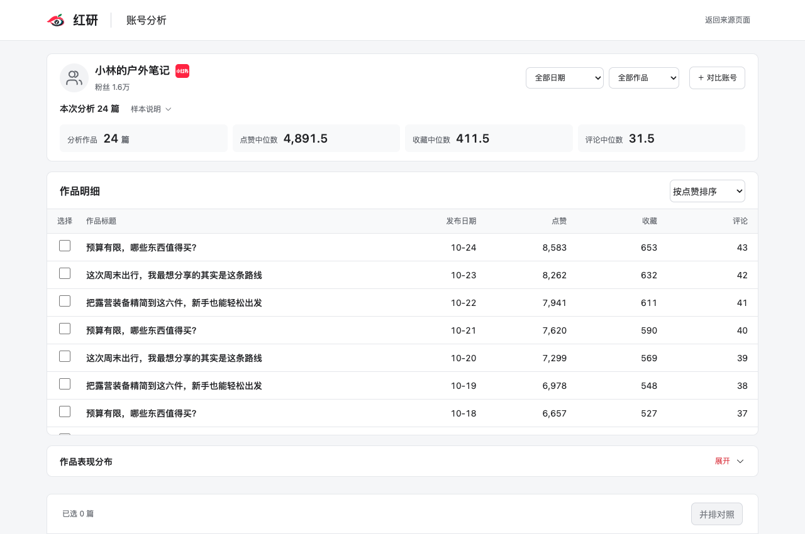
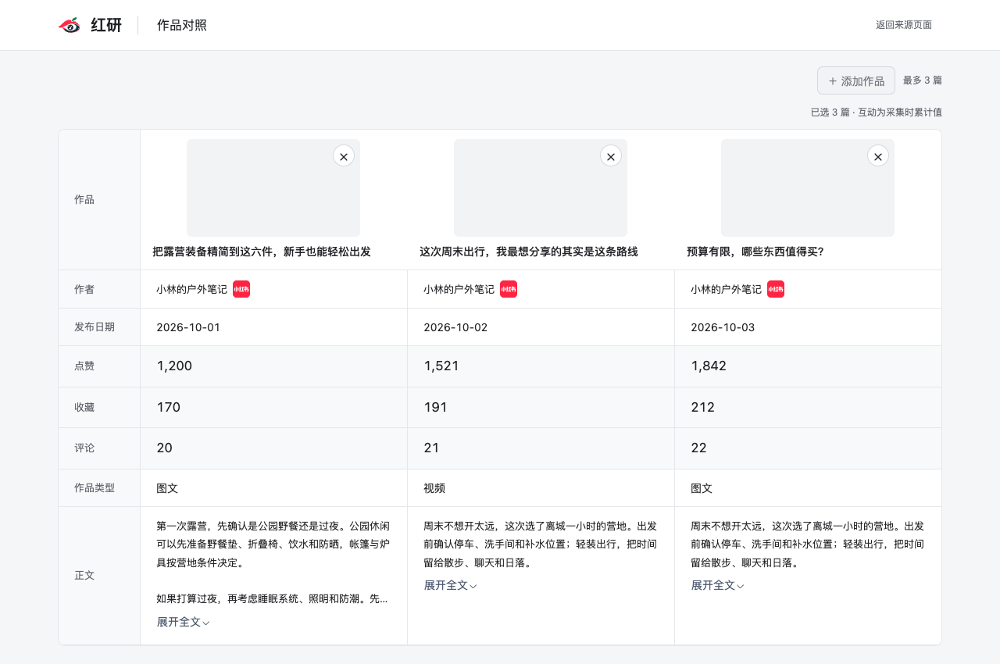
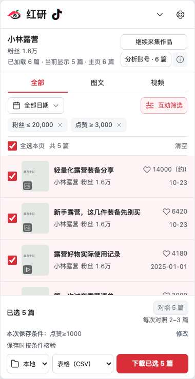
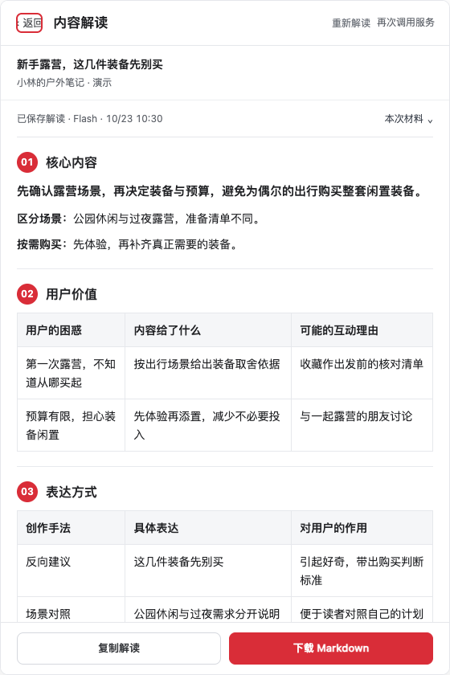

  

<h1 align="center">红研 · 小红书与抖音选题研究插件</h1>

发现选题 · 研究对标 · 解读内容 · 整理资料

把值得研究的图文、视频与评论，保存到本地、飞书或 Obsidian。

  <a href="#主要功能">主要功能</a> ·
  <a href="#快速开始">快速开始</a> ·
  <a href="docs/downloads.md">下载与安装</a> ·
  <a href="docs/guide.md">使用教程</a> ·
  <a href="https://github.com/zhangxun-ai/Hongyan-extension/issues/new/choose">问题反馈</a>

红研是一款桌面浏览器插件，适合寻找选题、研究对标账号和积累创作资料的内容创作者。在平台页面上筛选与选择作品，按需分析账号、获取逐字稿或解读内容，再导出或保存到自己的资料库。

> **版本说明**：下文介绍新版 `26.10.23.1` 的功能。抖音适配、账号研究、内容解读与本地 Whisper 已在开发版实现，尚未公开发布；当前 [公开下载版本](docs/downloads.md) 为 `26.10.16.12`，不包含这些新功能。插件免费，源码另行授权。

## 主要功能

| 你想做什么 | 红研可以帮你 |
| --- | --- |
| **寻找选题** | 查看当前已加载首页作品的图文／视频 Top10 和 10W+ 内容；拓展搜索关键词，导出 CSV 词表与 HTML 词图。 |
| **筛选作品** | 按日期、图文／视频类型收窄列表，用粉丝上限和点赞下限寻找低粉高赞作品。 |
| **研究对标账号** | 分析已加载作品的互动表现，对比两个同平台账号；选取 2—3 篇作品，并排查看标题、指标与正文。 |
| **解读单篇内容** | 在作品详情中查看「核心内容、用户价值、表达方式」，复制结果或下载 Markdown。需配置自己的 DeepSeek API Key。 |
| **获取视频逐字稿** | 选择本地 Whisper 或豆包云端转录，导出 TXT、Markdown 和 SRT 字幕（SRT 需有效时间轴）；已取得的逐字稿可复用。 |
| **保存创作资料** | 导出 CSV 或本地图文 HTML，保存到飞书多维表格、Obsidian；可单独下载能取得原图或媒体地址的图片、视频。 |
| **整理评论** | 小红书支持评论采集与已保存笔记的评论补采；抖音支持导出当前作品已加载的评论。 |
| **查看保存任务** | 飞书保存支持后台排队、进度与结果查看；任务提交成功后可以离开来源页面。 |

## 界面预览

查看账号分析、作品对照、抖音工作区与内容解读

下图使用当前开发版的实际界面与演示数据，不代表真实账号、采集结果或 AI 分析结论。点击可查看大图。

| 账号分析 | 作品并排对照 |
| :---: | :---: |
|  |  |
| 抖音筛选与采集 | 单篇内容解读 |
|  |  |

## 平台与功能范围

新版支持小红书、抖音的首页、搜索页、博主主页与作品详情，按当前网站显示对应工作区。

| 功能 | 小红书 | 抖音 |
| --- | --- | --- |
| 作品筛选、资料保存、账号分析与作品对照 | 支持 | 支持 |
| 关键词拓展 | 关联词拓展、CSV／HTML 词图 | 原生搜索下拉联想逐层拓展、CSV／离线 HTML 词图 |
| 搜索赛道导出 | 支持 | — |
| 评论 | 有限范围采集、导出与补采 | 导出本页已加载评论，需先在平台展开评论 |
| 视频逐字稿与单篇内容解读 | 支持 | 支持 |

首页榜单与账号分析基于本次已加载样本，不代表全站排名、账号历史全集或增长趋势；账号对比限同一平台。未取得的指标留空，真实 0 保留，平台约数不冒充精确值。

## 快速开始

1. **安装并刷新页面**：按[安装说明](docs/downloads.md)启用红研，固定到浏览器工具栏，刷新平台页面。先确认安装版本支持所需功能。
2. **浏览与选择**：在首页、搜索页或博主主页加载作品，按日期、类型或互动条件筛选，再勾选需要的内容；详情页直接操作当前作品。
3. **研究或保存**：点击「分析账号」「并排对照」，或选择本地、飞书、Obsidian 保存。视频逐字稿和内容解读按需单独使用。

| 保存位置 | 首次使用准备 | 保存形式 |
| --- | --- | --- |
| **本地** | 无需连接资料库 | CSV 表格、图文 HTML；逐字稿单独下载 |
| **飞书** | 按引导导入模板，填写自己的 Base 链接与授权码，完成连接检查 | 多维表格中的作品与对标博主资料 |
| **Obsidian** | 选择并授权本地知识库目录 | Markdown 与图片资料 |

**筛选提示**：列表筛选决定当前看见和选择的作品；保存／导出另按底栏显示的输出条件核验。「已选 N 篇」表示选择数量，实际完成数以任务结果为准。账号分析按已加载作品及日期／类型统计，不套用低粉高赞条件。

[查看详细操作、转录配置与常见问题 →](docs/guide.md)

## 费用与数据

- **插件免费**：无需激活，无试用期限。免费使用不包含商业源码授权。
- **本地 Whisper**：需安装独立助手和模型，使用本机算力，不产生云端转录接口费用；不会自动切换到付费云端。Apple Silicon Mac 已有实机验证，其他桌面系统仍需分别验证。
- **云端转录与内容解读**：自行配置豆包／DeepSeek 服务，费用由对应服务商收取。新增云端转录需确认；内容解读仅在主动点击后调用，重新解读会再次请求模型。
- **数据去向**：选择云端转录时，媒体材料提交给对应转录服务；内容解读会将所用正文、逐字稿、图片／关键帧及评论样本发送给 DeepSeek，具体取决于模型与可用材料。Pro 仅分析文字。
- **密钥与结果**：服务密钥保存在本机扩展中，不写入网页或导出。已完成解读按作品与模型保留最新成功结果，重开直接复用；结果需主动复制或下载，不自动写入飞书／Obsidian。

## 使用边界与帮助

- 仅处理页面可访问、已取得的材料；评论不保证全量，关键词联想不等于搜索量，媒体下载与转录取决于可用地址、音轨和权限。
- 作者自测暂未遇到封控，但不保证零风险。担心账号安全可先用小号测试；出现平台提醒或异常时暂停并按平台提示处理。
- [使用教程](docs/guide.md) · [下载与更新](docs/downloads.md) · [提交问题](https://github.com/zhangxun-ai/Hongyan-extension/issues/new/choose)
- [官网与联系作者](https://extensions.zhangxun.org/hongyan/) · [隐私说明](https://extensions.zhangxun.org/hongyan/privacy/) · [support@zhangxun.org](mailto:support@zhangxun.org)

反馈时附插件版本、浏览器版本和复现步骤，遮挡个人信息，勿提交 API Key、授权码或 Cookie。源码须[联系作者获得授权](https://extensions.zhangxun.org/hongyan/#wechat)，加入作者的 GitHub 私有仓库后获取。

本公开仓库用于产品介绍、使用说明、版本下载与问题反馈，不包含扩展开发源码。
