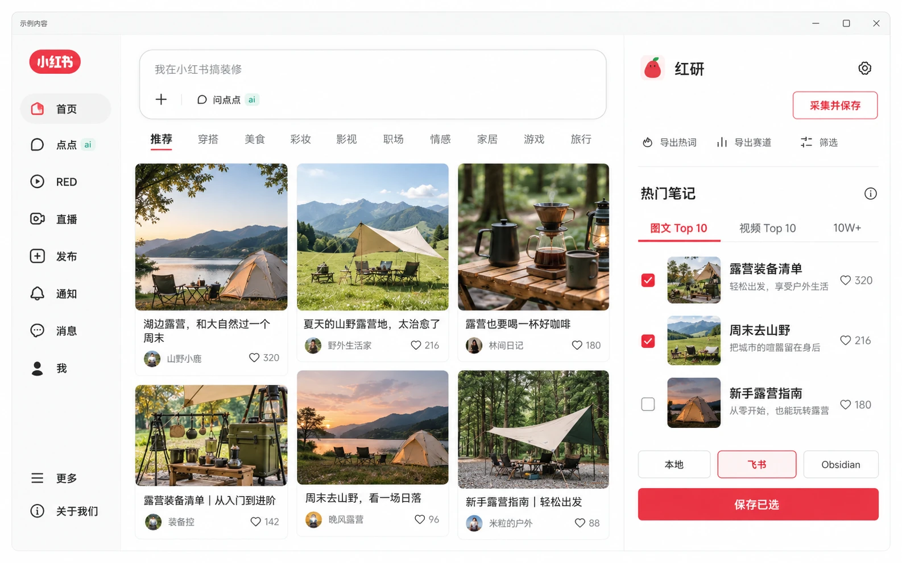
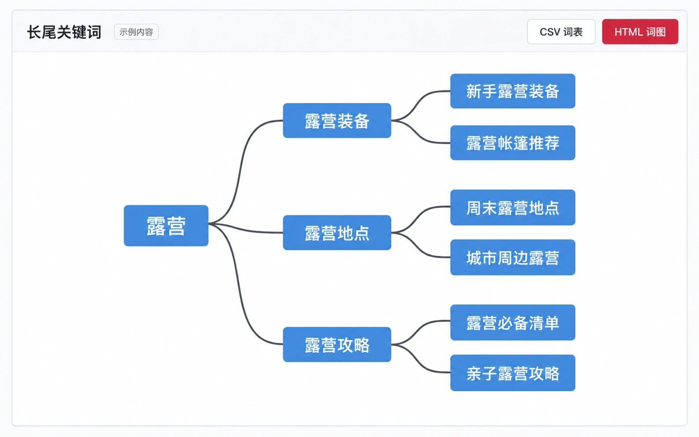
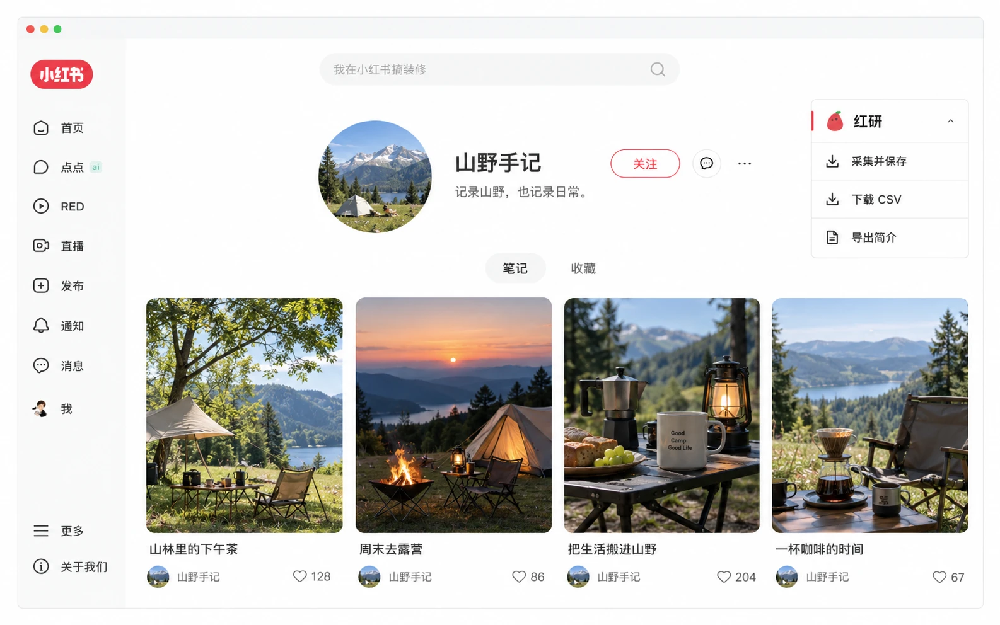

  

<h1 align="center">红研 · 小红书选题与资料整理插件</h1>

免费整理小红书图文、视频与评论，保存到本地、飞书或 Obsidian。

  <a href="https://extensions.zhangxun.org/hongyan/">访问官网</a> ·
  <a href="https://extensions.zhangxun.org/downloads/hongyan-free.zip">免费下载</a> ·
  <a href="docs/guide.md">使用教程</a> ·
  <a href="https://github.com/zhangxun-ai/Hongyan-extension/releases">版本下载</a> ·
  <a href="https://github.com/zhangxun-ai/Hongyan-extension/issues/new/choose">问题反馈</a>

红研是一款浏览器插件，适合需要寻找小红书选题、研究对标账号、整理笔记资料的创作者。你可以在浏览时筛选内容，导出 CSV，或将选中的笔记保存到本地、飞书多维表格和 Obsidian。

## 主要功能

| 功能 | 用途 |
| --- | --- |
| **首页热门榜单** | 查看图文 Top10、视频 Top10 和 10W+ 热门笔记，勾选值得研究的内容。 |
| **长尾关键词** | 从搜索关键词拓展关联词，导出 CSV 词表和 HTML 树状词图。 |
| **搜索赛道** | 整理搜索页的赛道分类，寻找更具体的选题方向。 |
| **笔记采集** | 在首页、搜索页、博主主页和详情页采集正文、图片及互动数据。 |
| **评论采集** | 采集并导出评论，也可为已保存的笔记补采评论。 |
| **筛选与保存** | 按日期、图文/视频类型及互动条件筛选已加载内容，下载 CSV 或保存到自己的资料库。 |
| **视频与逐字稿** | 下载可取得的视频，配置转录服务后获取逐字稿，导出 TXT、Markdown 和具有可用时间信息的 SRT。 |
| **对标资料库** | 飞书模板包含笔记库、对标博主与博主分析；Obsidian 首次连接自动准备目录、模板和资料视图。 |

## 界面预览

| 首页热门榜单 | 长尾关键词词图 |
| :---: | :---: |
|  |  |
| 搜索页采集 | 博主主页研究 |
|  |  |

以上为功能示意图，实际界面以安装版本为准。点击图片可以查看大图。

## 获取与安装

当前免费版 **26.10.16.12**，无需激活、没有试用倒计时。

- [官网下载 ZIP](https://extensions.zhangxun.org/downloads/hongyan-free.zip)
- [GitHub 下载与更新说明](https://github.com/zhangxun-ai/Hongyan-extension/releases/tag/v26.10.16.12)
- [Chrome 应用商店](https://chromewebstore.google.com/detail/pjdbnlfpofkgcglogmdgplamgabooceo)：免费版 26.10.16.12 已提交审核，尚未上架，请先使用 ZIP，并以商店实际显示的版本为准。

ZIP 需要解压后在扩展管理页选择“加载已解压的扩展程序”。[查看安装与更新步骤 →](docs/downloads.md)

## 三步开始使用

1. **安装并启用**：按安装说明添加红研，固定到浏览器工具栏，然后刷新小红书页面。
2. **发现并选择**：浏览首页热门榜单，或进入搜索页、博主主页、笔记详情页，采集并勾选需要的笔记。
3. **导出或保存**：下载 CSV 或本地图文资料，也可连接飞书多维表格、Obsidian 后保存已选笔记。

使用本地导出无需连接资料库。飞书使用自己的 Base 链接和授权码；Obsidian 选择本地知识库目录。[查看完整教程与常见问题 →](docs/guide.md)

## 免费插件与商业源码授权

当前插件免费使用，无需购买激活码。视频转录为可选功能，需要自行配置第三方服务，相关服务费用由服务商单独收取。

如果希望基于项目源码开发商业产品，可[联系作者咨询商业源码授权](https://extensions.zhangxun.org/hongyan/#wechat)。源码通过私有仓库提供，具体费用、交付范围与授权条款另行约定；免费使用插件不代表获得商业源码授权。本公开仓库提供产品文档与安装包。

## 使用范围

- 首页榜单来自当前页面已加载的笔记，用于浏览和选题研究。
- 同时启用点赞与评论筛选时，笔记需同时满足两项条件。
- 评论采集是有限样本，结果会说明采集范围；视频下载需有可用媒体地址，转录需要配置服务并明确启用。
- 关键词 HTML 词图打开时需要联网。

## 帮助与反馈

- 使用教程：[安装、采集与保存](docs/guide.md)
- 故障与建议：[提交 Issue](https://github.com/zhangxun-ai/Hongyan-extension/issues/new/choose)
- 商业源码授权咨询：[官网入群](https://extensions.zhangxun.org/hongyan/#wechat) / [support@zhangxun.org](mailto:support@zhangxun.org)
- 产品信息：[官网](https://extensions.zhangxun.org/hongyan/) · [隐私说明](https://extensions.zhangxun.org/hongyan/privacy/) · [更新日志](https://extensions.zhangxun.org/hongyan/changelog/)

本仓库用于产品介绍、使用说明、版本下载与问题反馈。
